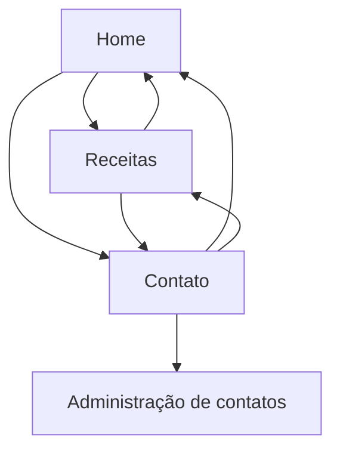

# Site de Receitas Fit

Projeto desenvolvido para a AV2 da disciplina **DWS — Desenvolvimento de Websites**.

## Nome e descrição

O **Site de Receitas Fit** reúne receitas saudáveis e fáceis para pessoas que desejam melhorar a alimentação no dia a dia. O visitante pode navegar entre a página inicial, consultar e pesquisar receitas e enviar uma mensagem pelo formulário de contato.

## Páginas

- `index.html`: página inicial.
- `receitas.html`: catálogo e pesquisa de receitas.
- `contato.html`: formulário de contato.
- `php/listar.php`: área de administração dos contatos (CRUD).

## Sitemap

## Como executar no XAMPP

1. Coloque a pasta `DWS` dentro de `htdocs`.
2. Inicie **Apache** e **MySQL** no XAMPP.
3. Abra o phpMyAdmin e importe o arquivo `banco.sql`.
4. Acesse `http://localhost/DWS/`.
5. Para demonstrar o CRUD, envie o formulário de contato e abra `http://localhost/DWS/php/listar.php`.

## Estrutura

- `css/`: estilos externos e responsivos.
- `js/`: JavaScript externo.
- `img/`: arquivos de imagem do projeto.
- `config/`: conexão com o banco de dados.
- `php/`: operações de cadastrar, listar, editar e excluir.
