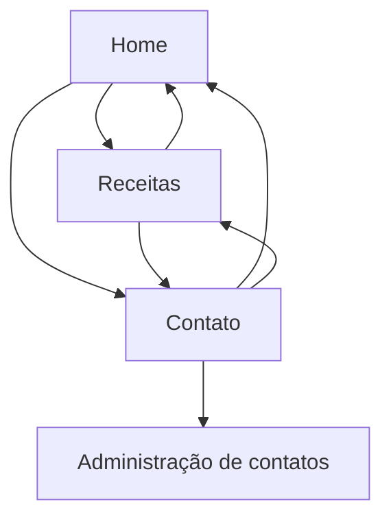

# Site de Receitas Fit

Projeto desenvolvido para a AV2 da disciplina **DWS — Desenvolvimento de Websites**.

## Nome e descrição

O **Site de Receitas Fit** reúne receitas saudáveis e fáceis para pessoas que desejam melhorar a alimentação no dia a dia. O visitante pode navegar entre a página inicial, consultar e pesquisar receitas e enviar uma mensagem pelo formulário de contato.

## Páginas

- `index.html`: página inicial.
- `receitas.html`: catálogo e pesquisa de receitas.
- `contato.html`: formulário de contato.
- `php/listar.php`: área de administração dos contatos (CRUD).

## Sitemap



## Como executar no XAMPP

1. Coloque a pasta `DWS` dentro de `htdocs`.
2. Inicie **Apache** e **MySQL** no XAMPP.
3. Abra o phpMyAdmin e importe o arquivo `banco.sql`.
4. Acesse `http://localhost/DWS/`.
5. Para demonstrar o CRUD, envie o formulário de contato e abra `http://localhost/DWS/php/listar.php`.

## Estrutura

- `css/`: estilos externos e responsivos.
- `js/`: JavaScript externo.
- `img/`: arquivos de imagem do projeto.
- `config/`: conexão com o banco de dados.
- `php/`: operações de cadastrar, listar, editar e excluir.

## Publicação no GitHub Pages

A pasta `docs/` contém a versão estática do site, com Home, Receitas, Contato, CSS e pesquisa de receitas em JavaScript.

1. Abra **Settings → Pages** no repositório.
2. Em **Source**, escolha **Deploy from a branch**.
3. Selecione a branch **main** e a pasta **/docs** e clique em **Save**.
4. Aguarde a publicação e confira as três páginas no endereço informado pelo GitHub.

Site publicado e verificado: https://bacoluso2.github.io/DWS/

**Atenção:** o GitHub Pages não executa PHP nem MySQL. O formulário público é demonstrativo e não envia mensagens; o CRUD continua disponível na versão local, seguindo as instruções do XAMPP acima. Somente a pasta `docs/` deve ser publicada.

Referência: https://docs.github.com/pt/pages/getting-started-with-github-pages/creating-a-github-pages-site

## Versionamento e entrega

O planejamento, as mensagens dos commits e os links para entregar ao professor estão em [PLANEJAMENTO.md](PLANEJAMENTO.md).

Para ter uma cópia local com o histórico completo:

```bash
git clone https://github.com/bacoluso2/DWS.git
cd DWS
git remote -v
git log --oneline
```

O clone já inicializa o Git e configura `origin`. Não é necessário executar `git init` novamente.

Para registrar e publicar futuras mudanças:

```bash
git add caminho/do/arquivo
git commit -m "Descreve a alteração realizada"
git push origin main
```
